<div align="center">


# Nyummy Backend Server

> 이 성과는 2026년도 과학기술정보통신부의 재원으로 정보통신기획평가원의 지원을 받아 수행된 연구임. (IITP-2026-SW마에스트로과정) <br><br> This work was supported by the Institute of Information & Communications Technology Planning & Evaluation(IITP) grant funded by the Ministry of Science and ICT(MSIT) (IITP-2026-SW Maestro training course).

</div>

## 목차

- [1. 프로젝트 개요](#1-프로젝트-개요)
  - [1-1. 프로젝트 소개](#1-1-프로젝트-소개)
  - [1-2. 시스템 구성도](#1-2-시스템-구성도)
  - [1-3. 주요 기능](#1-3-주요-기능)
  - [1-4. 개발 환경](#1-4-개발-환경)
- [2. 개발 결과물](#2-개발-결과물)
  - [2-1. 백엔드 아키텍처](#2-1-백엔드-아키텍처)
  - [2-2. AWS 아키텍처](#2-2-aws-아키텍처)
  - [2-3. 데이터베이스 ERD](#2-3-데이터베이스-erd)
  - [2-4. API 문서화 및 테스트](#2-4-api-문서화-및-테스트)
  - [2-5. CI/CD 파이프라인](#2-5-cicd-파이프라인)
  - [2-6. AI 기반 영양 분석](#2-6-ai-기반-영양-분석)
  - [2-7. AI 영양 리포트 데이터 파이프라인 구축](#2-7-ai-영양-리포트-데이터-파이프라인-구축)
  - [2-8. 워커 서버 분리 및 SQS 도입](#2-8-워커-서버-분리-및-sqs-도입)
  - [2-9. CDC 도입 과정](#2-9-cdc-도입-과정)
  - [2-10. 인증 시스템](#2-10-인증-시스템)
  - [2-11. 관측(Observability)](#2-11-관측observability)
- [3. 수행 방법 및 프로젝트 관리](#3-수행-방법-및-프로젝트-관리)
  - [3-1. 개발 프로세스](#3-1-개발-프로세스)
  - [3-2. 형상 관리 프로세스](#3-2-형상-관리-프로세스)
  - [3-3. 네이밍 컨벤션](#3-3-네이밍-컨벤션)
- [4. 개발 가이드](#4-개발-가이드)
  - [4-1. E2E 테스트](#4-1-e2e-테스트)
  - [4-2. DB 마이그레이션](#4-2-db-마이그레이션)

## 1. 프로젝트 개요

### 1-1. 프로젝트 소개

사진 한 장으로 식사를 기록하고, 고양이 냐미를 돌보며 기록 습관을 만드는 앱입니다.

식단 기록 앱은 입력이 번거로워서 며칠 쓰다 멈추기 쉽습니다. 냐미는 기록을 사진 한 장으로 줄이고, 기록할 때마다 냐미가 반응하고 보상을 주는 흐름으로 다시 앱을 열 이유를 만듭니다.

### 1-2. 시스템 구성도

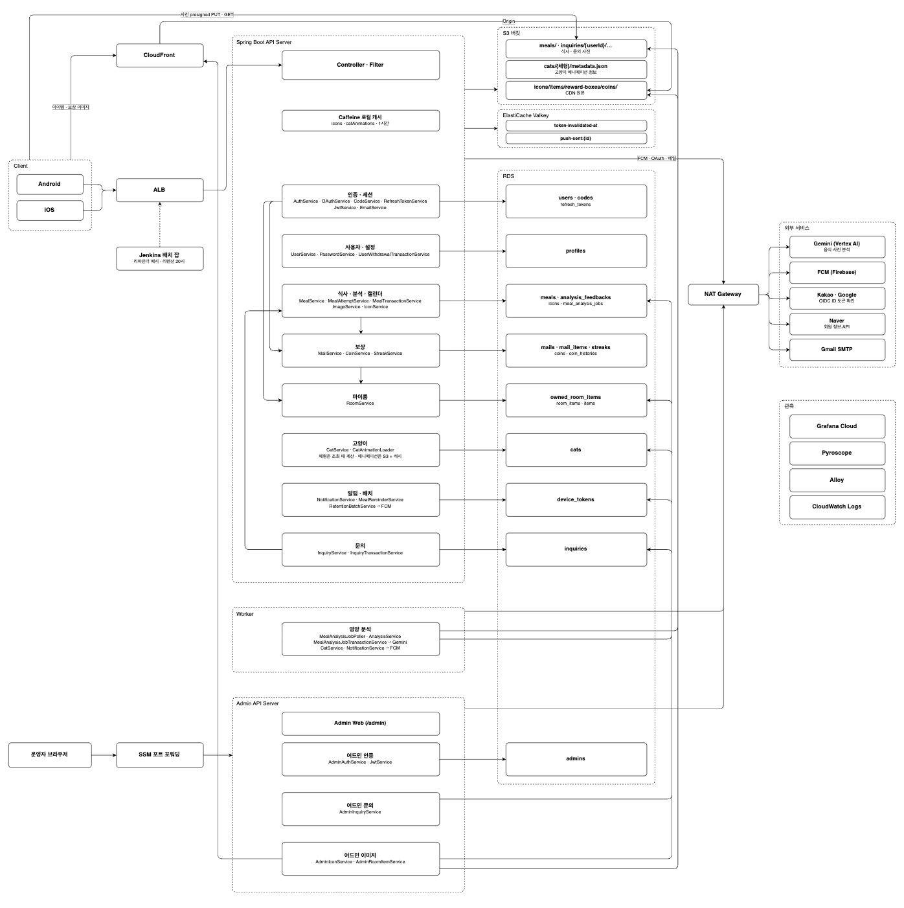

### 1-3. 주요 기능

<table>
  <tr><td align="center"><b>시작하기</b></td><td align="center"><b>홈</b></td><td align="center"><b>식사 기록</b></td><td align="center"><b>마이룸</b></td></tr>
  <tr><td align="center"></td><td align="center"></td><td align="center"></td><td align="center"></td></tr>
  <tr><td align="center"><sub>골목에서 냐미를 만나는 온보딩</sub></td><td align="center"><sub>꾸민 방에서 말을 거는 냐미</sub></td><td align="center"><sub>촬영, 냐미가 먹는 연출, 보상 상자</sub></td><td align="center"><sub>아이템을 꺼내고 옮겨 방 꾸미기</sub></td></tr>
  <tr><td align="center"><b>우편함</b></td><td align="center"><b>기록 돌아보기</b></td><td align="center"><b>설정</b></td></tr>
  <tr><td align="center"></td><td align="center"></td><td align="center"></td></tr>
  <tr><td align="center"><sub>보상 상자 열기, 모두 받기</sub></td><td align="center"><sub>캘린더, 하루 영양, 식사 상세</sub></td><td align="center"><sub>식사 시간 알림, 문의 내역</sub></td></tr>
</table>

| 기능 | 서버가 하는 일 | 패키지 |
|---|---|---|
| 시작하기 | 이메일 인증 코드로 회원가입, 이메일·카카오·구글·네이버 로그인, 비밀번호 재설정, 토큰 재발급, 튜토리얼 | `auth` `user` |
| 식사 기록 | 업로드 URL 발급과 이미지 검증, 식사 저장, Worker의 AI 영양 분석, 실패 시 재시도, 하루 기록 횟수 제한 | `image` `meal` `worker` |
| 홈 | 냐미 상태, 오늘의 식사 요약, 연속 기록(스트릭), 장착한 마이룸 아이템, 우편함 배지 | `home` `cat` `streak` |
| 마이룸 | 보유 아이템 조회, 장착·배치 저장 | `room` `item` |
| 우편함 | 식사 보상 상자 우편, 하나 받기·모두 받기, 코인 지급 | `mail` `coin` |
| 기록 돌아보기 | 월간 캘린더, 하루 영양 평가, 식사 상세·이름 수정·삭제, 분석 평가 | `meal` |
| 설정 | 식사 시간 알림·수신 설정, 문의하기와 답변, 비밀번호 변경, 회원탈퇴 | `user` `inquiry` |
| 알림 | 분석 완료·식사 리마인더·리텐션 FCM 푸시, 기기 토큰 관리 | `notification` `internal` |
| 상점 | 추천·상품 목록·프로모션, 장바구니, 코인 구매, 코인 내역 | `shop` `coin` |
| 어드민 | 아이콘·마이룸 아이템·상품·프로모션·배너 관리, 문의 답변 | `admin` |

### 1-4. 개발 환경

- Back-end: `Kotlin 2.3`, `Java 25`, `Spring Boot 4.1`, `Spring Security`, `JPA`, `Flyway`, `MySQL`, `Redis(Valkey)`, `Caffeine`
- Infra: `AWS (EC2, ECS, Fargate, ALB, RDS, ElastiCache, S3, CloudFront, SES, ECR, Secrets Manager)`, `Docker`, `Nginx`, `Jenkins`
- Observability: `OpenTelemetry`, `Grafana Cloud`
- External: `Google Gemini API`, `Firebase Cloud Messaging`, `Kakao·Google·Naver OAuth`
- Test: `JUnit 5`, `MockK`, `Testcontainers`, `REST Assured(E2E)`, `k6(부하 테스트)`

## 2. 개발 결과물

### 2-1. 백엔드 아키텍처

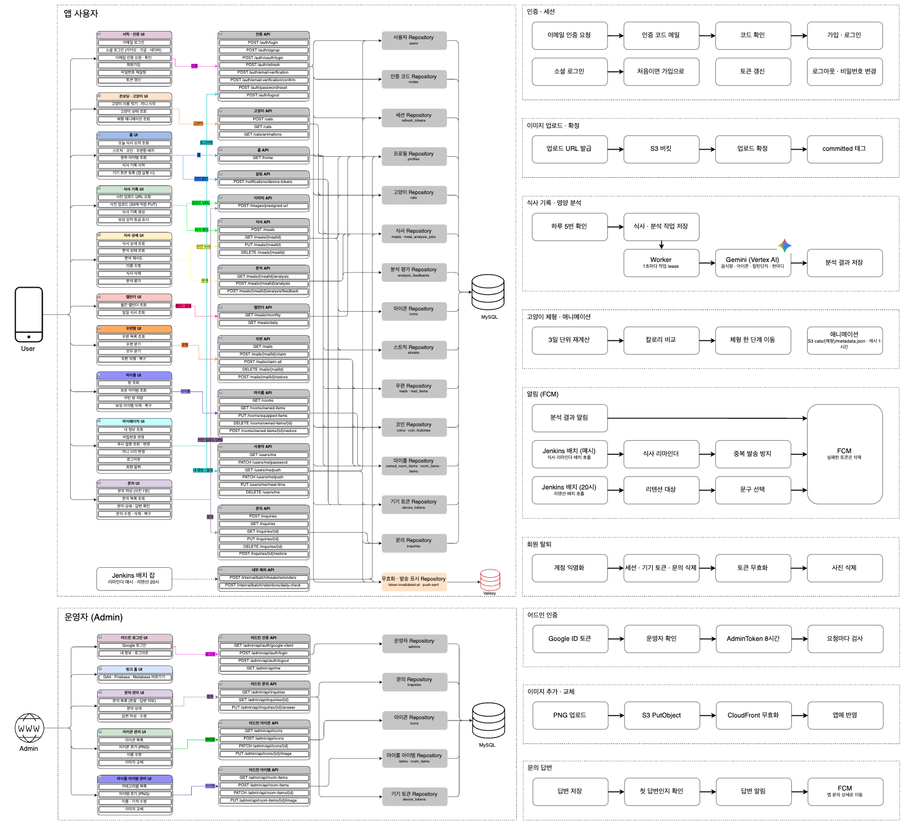

백엔드 아키텍처를 v1에서 v3까지 발전시켰습니다. 위 그림은 v3의 애플리케이션 아키텍처(AA)입니다.

<!-- TODO: 버전별로 바뀐 점과 이유 (v1 → v2 → v3) -->

<details>
<summary>v3 IA · AA · SA</summary>

**IA(Information Architecture) V3** (v2와 같음)
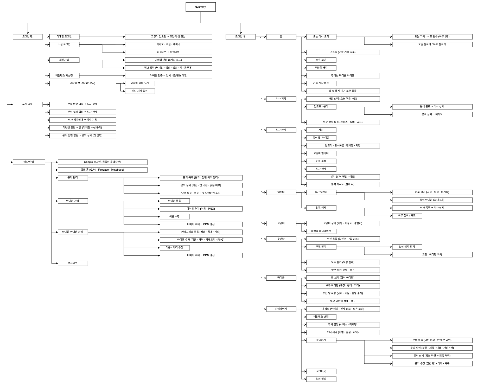
**AA(Application Architecture) V3**

**SA(System Architecture) V3**
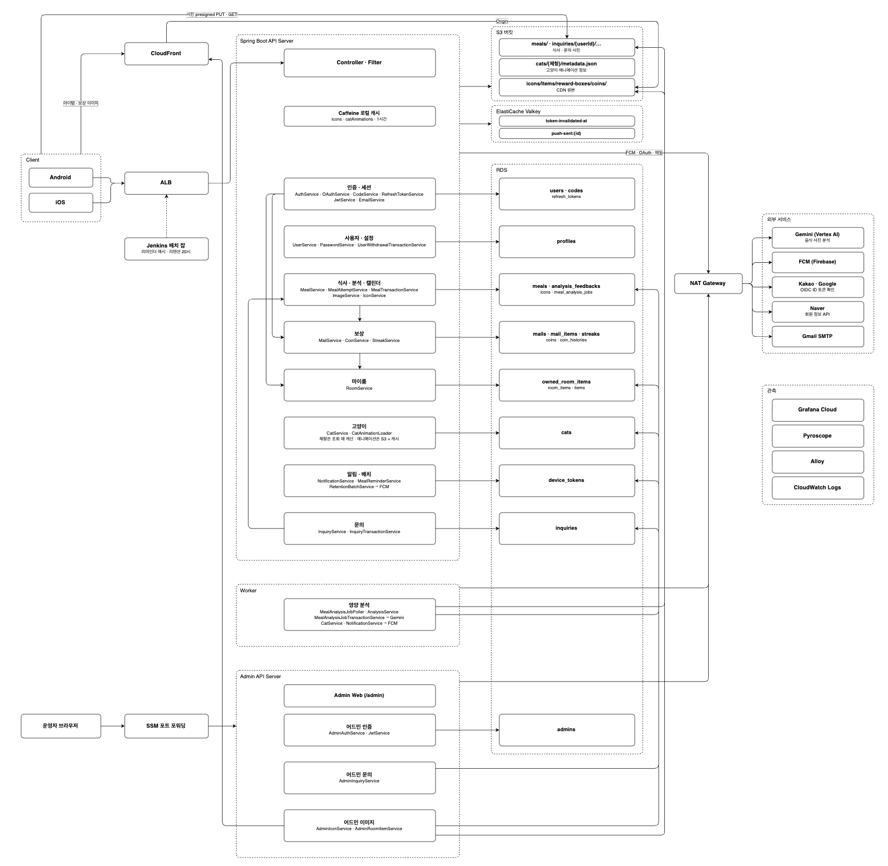

</details>

<details>
<summary>v2 IA · AA · SA</summary>

**IA(Information Architecture) V2**

**AA(Application Architecture) V2**
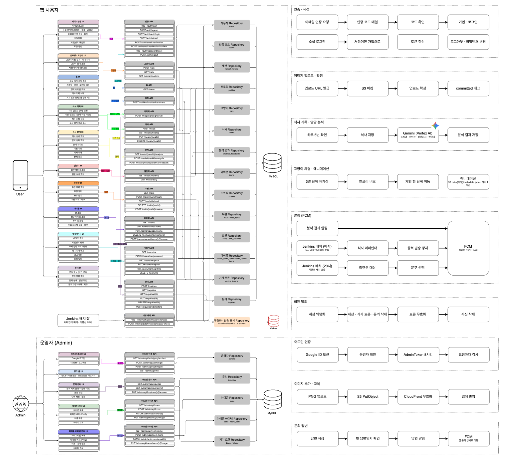
**SA(System Architecture) V2**
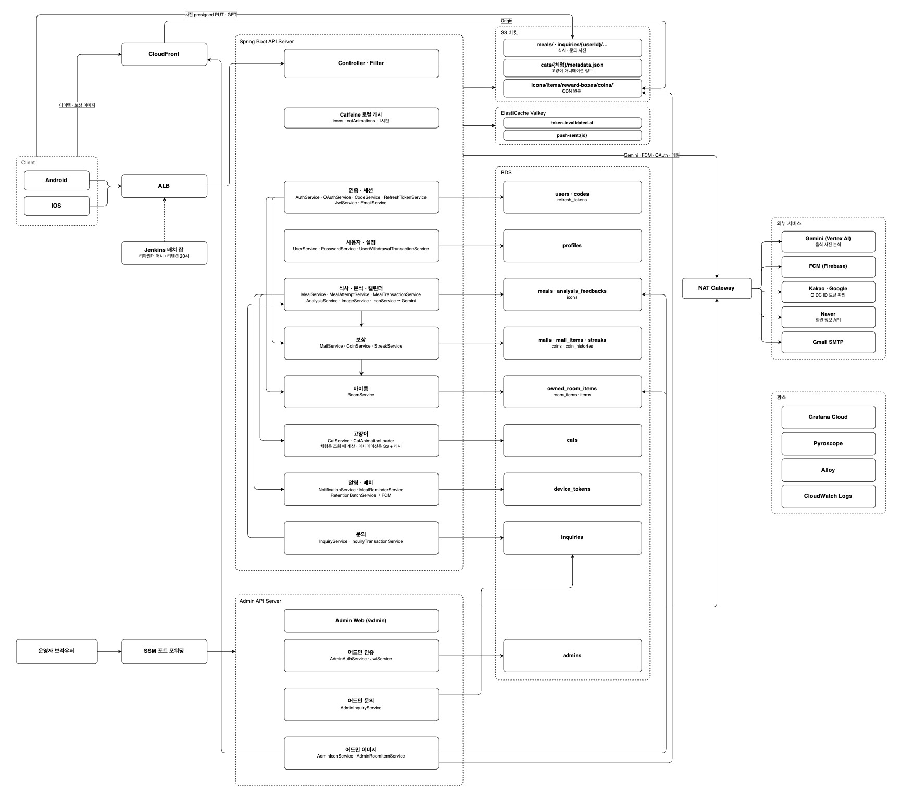

</details>

<details>
<summary>v1 IA · AA · SA</summary>

**IA(Information Architecture) V1**
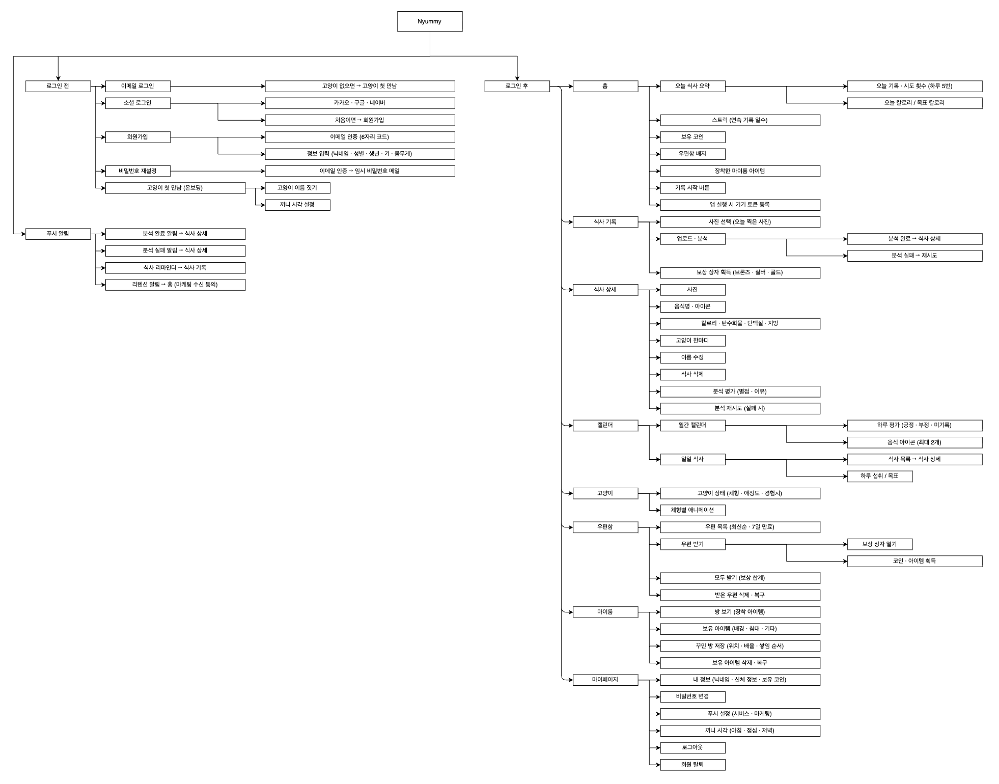
**AA(Application Architecture) V1**
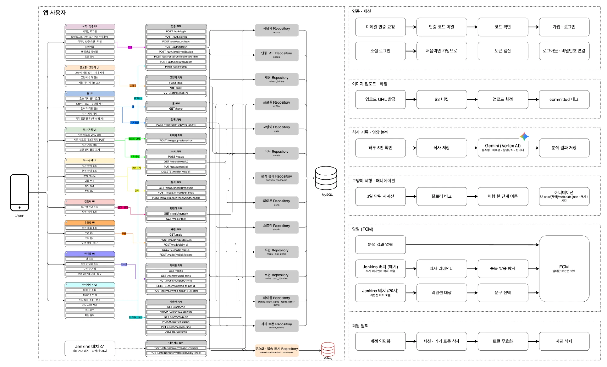
**SA(System Architecture) V1**
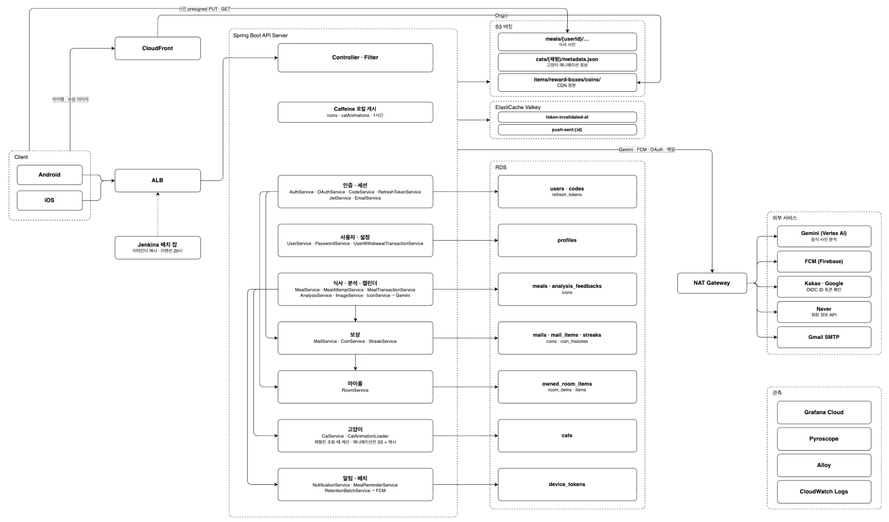

</details>

패키지는 역할에 따라 나누었습니다.

- **도메인**: `user`, `auth`, `cat`, `meal`, `streak`, `coin`, `item`, `room`, `shop`, `mail`, `inquiry`, `home`, `image`, `notification`
- **별도 진입점**
  - `worker`: 영양 분석 작업을 가져가 처리하는 Worker 서비스
  - `internal`: 외부 스케줄러가 부르는 배치 API(식사 리마인더·리텐션·오늘의 할인·판매량 갱신)
  - `admin`: 운영자 API와 웹
- **외부 연동**: `infra`(`ai`, `storage`, `email`, `oauth`, `push`, `cdn`). 인터페이스 뒤에 구현을 두어 바꿔 끼울 수 있게 했습니다(예: 이메일 SES ↔ SMTP).
- **공통**: `security`, `filter`, `header`, `exception`, `config`

### 2-2. AWS 아키텍처

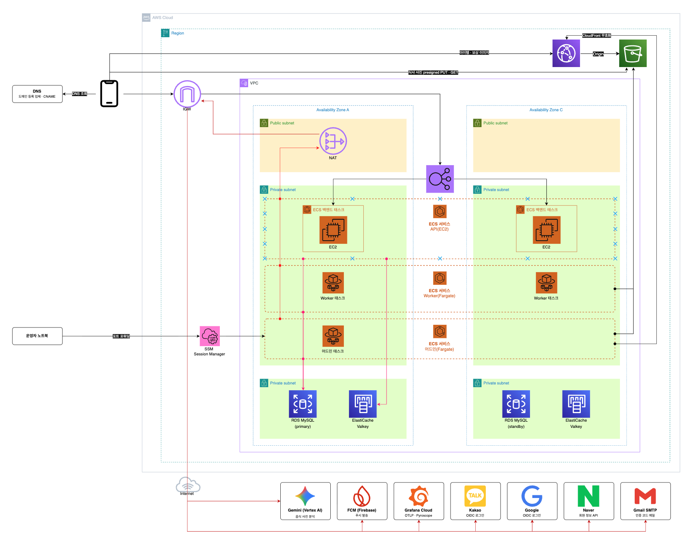

AWS 아키텍처를 v1에서 v3까지 발전시켰습니다. 위 그림은 v3입니다.

<!-- TODO: 버전별로 바뀐 점과 이유 (v1 → v2 → v3) -->

<details>
<summary>v2</summary>

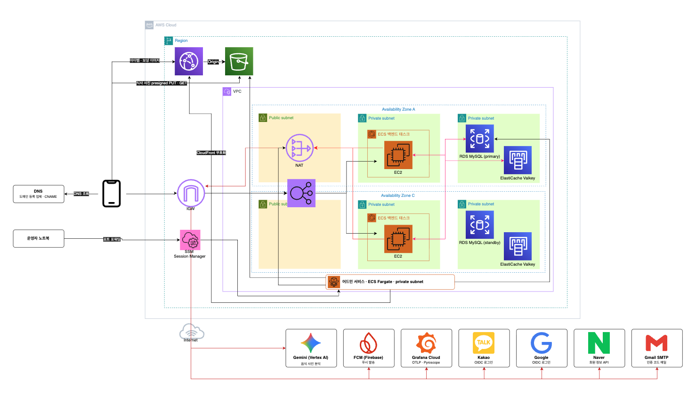

</details>

<details>
<summary>v1</summary>

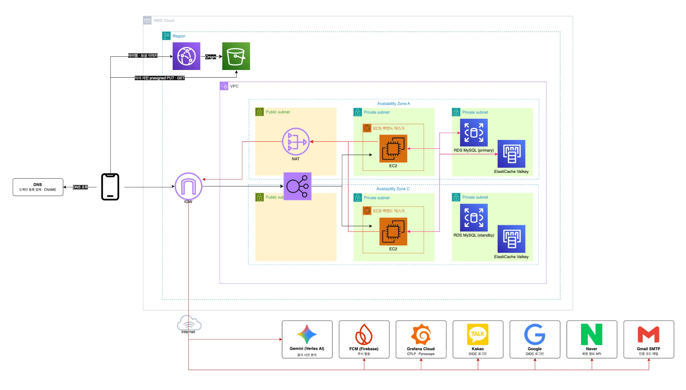

</details>

- **dev**: EC2 한 대에서 Docker Compose로 앱·MySQL·Valkey를 띄우고, Nginx에서 TLS를 종료합니다(Let's Encrypt).
- **prod**
  - API 서버는 ECS(EC2 호스트)에서 private subnet에 두고, public ALB로만 요청을 받습니다.
  - DB는 RDS(MySQL), 캐시는 ElastiCache(Valkey)를 씁니다.
  - 영양 분석 Worker는 같은 이미지를 별도 ECS 서비스(Fargate)로 띄웁니다.
  - 어드민은 같은 이미지에서 `app.admin.enabled`를 켠 별도 서비스로 띄우고, 외부 ALB에는 노출하지 않습니다.
  - 아이템·아이콘 같은 정적 이미지는 S3 앞에 CloudFront(`cdn.nyummy.co.kr`)를 두어 내려줍니다.
  - 비밀값은 Secrets Manager에서 태스크에 주입합니다.
- **부하 테스트 환경**: prod와 같은 구성을 따로 띄워 k6로 측정합니다.

<!-- TODO: VPC·서브넷 구성, 아키텍처 버전별 발전 과정 -->

### 2-3. 데이터베이스 ERD

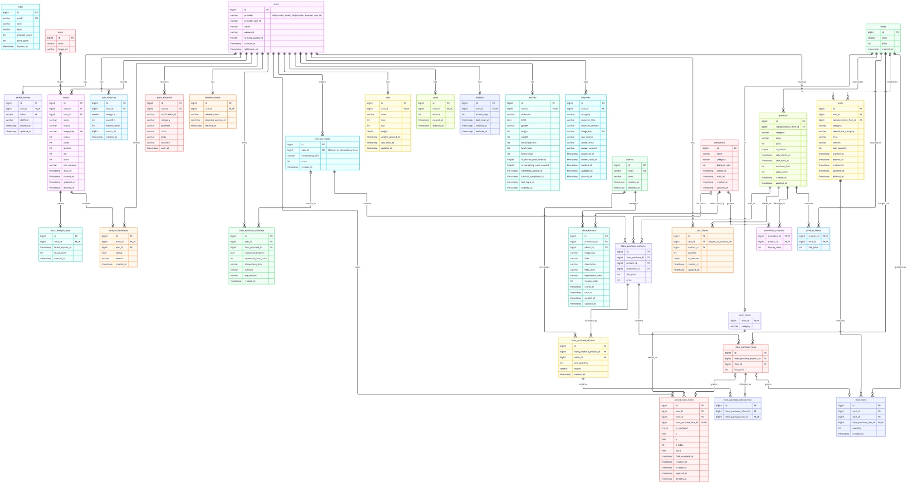

서비스 도메인에 맞춰 테이블을 설계했습니다.

| 도메인 | 테이블 |
|---|---|
| 사용자·인증 | `users`, `profiles`, `refresh_tokens`, `codes`, `admins` |
| 고양이·식사 | `cats`, `meals`, `meal_analysis_jobs`, `analysis_feedbacks`, `streaks`, `icons` |
| 코인·우편 | `coins`, `coin_histories`, `mails`, `mail_items` |
| 상점·마이룸 | `items`, `room_items`, `owned_room_items`, `products`, `product_items`, `promotions`, `promotion_products`, `shop_banners`, `cart_items`, `item_purchases`, `item_purchase_products`, `item_purchase_lines`, `item_purchase_attempts`, `item_purchase_refunds`, `item_purchase_refund_lines` |
| 알림·문의 | `device_tokens`, `push_histories`, `inquiries` |

- **이름 규칙**: 테이블은 복수형 snake_case로 짓습니다. 제약과 인덱스는 `fk_{테이블}_{참조 테이블}`, `uk_{테이블}_{컬럼}`, `idx_{테이블}_{컬럼}` 형식으로 이름을 직접 붙여, MySQL이 자동으로 정한 이름이 섞이지 않게 합니다.
- **생성·수정 시각**: JPA auditing(`@CreatedDate`, `@LastModifiedDate`)으로 생성·수정 시각을 자동으로 남깁니다.
- **소프트 삭제**: 식사·문의·우편·보유 아이템은 행을 지우지 않고 `deleted_at`을 남깁니다. 문의·우편·보유 아이템은 삭제를 되돌리는(restore) API도 있습니다.
- **탈퇴**: 탈퇴한 사용자는 행을 지우지 않고 탈퇴 시각을 남긴 뒤 개인정보를 익명화합니다.

스키마 변경은 Flyway 마이그레이션(`src/main/resources/db/migration/mysql`)으로 버전 관리하고, 앱이 기동할 때 적용합니다. 배포 중에는 구버전과 신버전이 같은 DB를 쓰므로, 구버전과 같이 돌 수 없는 변경은 나눠서 배포합니다([4-2. DB 마이그레이션](#4-2-db-마이그레이션)).

### 2-4. API 문서화 및 테스트

**Swagger**


springdoc-openapi로 OpenAPI 3 스펙 기반 API 문서를 제공합니다.

**API 테스트**

- 개발 중에는 `src/test/http`의 `.http` 파일로 도메인별 요청을 바로 보내 확인합니다.
- 배포된 서버에는 E2E 테스트가 실제 HTTP 요청을 보내 API 계약을 확인합니다([4-1](#4-1-e2e-테스트)).

### 2-5. CI/CD 파이프라인


Jenkins로 테스트부터 배포·배포 후 검증까지 자동화했습니다.

- **dev** (`Jenkinsfile`, main에 머지되면)
  1. Gradle 테스트
  2. Docker 이미지 빌드 → ECR 푸시. 태그는 `커밋 12자리-빌드 번호`입니다.
  3. SSM으로 dev EC2에서 배포 스크립트 실행
  4. dev 서버에 E2E 테스트 전체 실행
- **prod** (`Jenkinsfile.prod`, dev 배포에 성공한 이미지 태그를 골라 실행)
  1. 이미지와 현재 운영 상태 확인
  2. 수동 승인
  3. 새 Task Definition 등록 → ECS blue/green 배포 시작
  4. 트래픽을 옮기기 전 green 태스크에 smoke 테스트(`@Smoke`) 실행
  5. 트래픽 전환 → 배포 결과 확인
- **배치** (`jenkins/batch`): Jenkins cron이 내부 배치 API(`/api/v1/internal/**`)를 부릅니다. 식사 리마인더(매시), 리텐션, 오늘의 할인, 판매량 갱신이 있고, 실패하면 Discord로 알립니다.

<!-- TODO: GitHub Actions → Jenkins 이관 배경 -->

### 2-6. AI 기반 영양 분석


식사 사진 한 장으로 음식 이름과 칼로리·탄수화물·단백질·지방을 추출합니다.

- **Gemini 구조화 응답**: 응답 형식(JSON schema)을 지정해, 음식인지 여부와 거부 이유, 음식 이름, 영양 4종, 식사 아이콘, 고양이 코멘트를 정해진 필드로 받습니다.
- **실패 분류**: 실패를 일시적 오류·음식 아님·응답 해석 실패·잘못된 요청·설정 오류로 나눠, 다시 시도할지·사용자에게 어떻게 알릴지를 다르게 처리합니다([2-8](#2-8-워커-서버-분리-및-sqs-도입)).
- **분석 결과 평가**: 사용자가 분석 결과에 별점과 이유를 남겨(`analysis_feedbacks`) 분석 품질을 확인합니다.

<!-- TODO: 벡터 DB·임베딩 도입 — 무엇을 임베딩하고 어떻게 검색해 분석에 쓰는지, 도입 전후 정확도·속도 -->

### 2-7. AI 영양 리포트 데이터 파이프라인 구축


영양 분석 결과를 모아 AI 영양 리포트를 만드는 데이터 파이프라인을 구축합니다.

<!-- TODO: 파이프라인 구성(수집 → 가공 → 저장 → 리포트 생성), 리포트 주기·내용, 처리량·지연 수치 -->

### 2-8. 워커 서버 분리 및 SQS 도입


API 서버는 식사를 저장하고 바로 응답하고, 영양 분석은 별도 Worker 서비스가 처리합니다.

**1단계: Worker 분리와 DB 큐**

- **DB 큐**: 식사 저장과 같은 트랜잭션에서 분석 작업(`meal_analysis_jobs`)을 쌓습니다. 그래서 식사는 저장됐는데 작업이 빠지는 일이 없습니다.
- **Worker**: 같은 이미지를 별도 ECS 서비스로 띄우고, 그 서비스에서만 `app.worker.enabled`를 켭니다.
- **작업 가져가기(lease)**: Worker는 1초마다 실행기의 빈 자리만큼 작업을 가져갑니다. `SELECT … FOR UPDATE SKIP LOCKED`로 잠그기 때문에 여러 Worker가 같은 작업을 함께 가져가지 않습니다.
- **lease와 fencing**: 가져간 작업은 정해진 시간 동안 그 Worker가 쥡니다. Worker가 죽어 이 시간이 지나면 다른 Worker가 다시 가져갑니다. 결과는 가져갈 때 받은 번호(`lease_count`)가 그대로일 때만 써서, 늦게 끝난 Worker가 결과를 덮어쓰지 않습니다.
- **짧은 트랜잭션**: Gemini 호출은 트랜잭션 밖에서 하고, 결과는 짧은 트랜잭션으로 저장합니다(`MealAnalysisJobTransactionService`). 잠그는 순서는 작업 → 식사로 고정해 데드락을 막습니다.
- **실패 처리**
  - 요청 한도 초과·서버 오류·타임아웃 같은 일시적인 실패는 시도 횟수 안에서 다시 시도합니다.
  - 키·권한 같은 설정 오류는 시도 횟수를 쓰지 않고 1분 뒤로 미룹니다.
  - 음식 사진이 아니거나 응답을 해석하지 못하면 `FAILED`로 끝냅니다.
  - `FAILED`가 된 식사는 사용자가 재시도 API로 다시 요청할 수 있습니다.
- **상태와 알림**: 식사 상태는 `WAITING` → `ANALYZING` → `COMPLETED` / `FAILED`로 바뀝니다. 결과는 FCM 푸시로 알립니다. 분석 중에 식사가 지워졌으면 결과는 남기고 알림은 보내지 않습니다.
- **종료 처리**: 배포로 Worker가 내려갈 때는 새 작업을 멈추고, 처리 중인 작업이 끝나기를 기다립니다. 그 안에 끝나지 않은 작업은 일시적인 실패와 같은 규칙으로 정리합니다.
- **관측**
  - 대기 작업 수: `nyummy.meal.analysis.jobs.waiting`
  - 가장 오래 기다린 시간: `nyummy.meal.analysis.jobs.oldest.wait`
  - 시도 결과와 걸린 시간: `nyummy.meal.analysis`
  - 작업이 쌓인 때부터 끝날 때까지 걸린 시간: `nyummy.meal.analysis.elapsed`

<!-- TODO: Worker를 분리한 이유, 분리 전후 API 응답 시간·부하 테스트 수치 -->

**2단계: SQS 도입**

<!-- TODO: DB 큐에서 SQS로 바꾼 이유, 구조(큐·DLQ·가시성 타임아웃), 전환 과정, 전후 수치 -->

### 2-9. CDC 도입 과정


<!-- TODO: CDC를 도입한 이유, 구성(변경 이벤트를 어디서 읽어 어디로 보내는지), 도입 과정, 전후 비교 -->

### 2-10. 인증 시스템


- **AccessToken / RefreshToken**: JWT로 인증합니다. RefreshToken 한 행이 로그인 한 번(세션)이고, 재발급할 때마다 RefreshToken을 교체(rotate)합니다. 세션에는 절대 만료 시각(`absoluteExpiresAt`)이 있어 재발급을 이어 가도 무한히 늘어나지 않습니다.
- **이전 AccessToken 무효화**: 로그아웃·비밀번호 변경·비밀번호 재설정·탈퇴할 때 사용자별 무효화 시각(`invalidatedAt`)을 Redis에 남기고, 그보다 먼저 발급된 AccessToken은 만료 전이라도 거절합니다.
- **이메일 인증**: 인증 코드 확인 → `EmailChallengeToken` → `VerifiedToken` 순서로 회원가입·비밀번호 찾기를 진행합니다. 이 두 토큰은 서명만 하지 않고 JWE(A256GCM)로 암호화합니다.
- **소셜 로그인**
  - 카카오·구글: 앱에서 받은 ID 토큰을 서버가 OIDC로 검증합니다(JWKS 서명, 발급자, 대상, 만료, nonce).
  - 네이버: 앱에서 받은 액세스 토큰으로 네이버 사용자 정보 API를 조회합니다.
  - 로그인 제공자마다 계정을 따로 둡니다.
- **어드민**: 어드민 웹은 Google 로그인으로 운영자를 확인하고, `AdminToken`을 쿠키(`admin_token`)로만 주고받습니다. 비활성화한 운영자의 토큰은 만료 전이라도 거절합니다.

### 2-11. 관측(Observability)


메트릭·트레이스·로그·프로파일을 Grafana Cloud에서 함께 봅니다.

- **메트릭·트레이스·로그**: Spring Boot OpenTelemetry로 OTLP를 Grafana Cloud에 바로 보냅니다. JDBC 쿼리도 span으로 남겨 요청 하나가 어떤 쿼리를 썼는지 봅니다(datasource-micrometer).
- **프로파일**: Pyroscope Java agent로 프로파일을 보냅니다.
- **DB·호스트 지표**: MySQL과 호스트 지표는 Grafana Alloy로 수집합니다(`deploy/alloy-db`, `deploy/alloy-node`).
- **직접 만든 지표**: 이름을 `nyummy.`로 시작합니다(예: 분석 작업 큐 지표, [2-8](#2-8-워커-서버-분리-및-sqs-도입)).
- 개인정보는 로그·span에 남기지 않습니다.
- 대시보드·알림 구성은 `docs/grafana-*.md`에 정리했습니다.

<!-- TODO: 대시보드 구성, 관측으로 발견한 문제 -->

## 3. 수행 방법 및 프로젝트 관리

### 3-1. 개발 프로세스


<!-- TODO: 스프린트 방식, 이슈 관리 도구, 회고 -->

### 3-2. 형상 관리 프로세스


- 각자 포크에서 작업마다 브랜치를 만들어 팀 저장소 `main`으로 PR을 올리고, PR 하나를 커밋 하나로 합쳐(Squash) 머지합니다.
- 커밋 메시지는 `feat`·`fix`·`refactor`·`chore`·`docs`·`test` 접두어로 시작합니다.
- PR 본문은 템플릿(`.github/pull_request_template.md`)을 따르고, 스키마를 바꾸면 구버전과 같이 돌 수 있는지 DB 마이그레이션 체크리스트로 확인합니다.
- 커밋하기 전에 pre-commit 훅이 Spotless(ktlint)로 코드 스타일을 맞춥니다.

<!-- TODO: PR 리뷰 규칙 -->

### 3-3. 네이밍 컨벤션

같은 개념에 여러 영어 단어가 섞이지 않도록 용어 사전([CLAUDE.md](./CLAUDE.md))을 운영합니다.

- **동사**: 개념마다 쓸 단어와 금지어를 정합니다(예: 조회는 `get`, `find`·`fetch` 금지).
- **클래스 접미사**: 용도마다 접미사를 하나로 정합니다(예: 응답 DTO `~Response`, 외부 연동 `~Client`).
- **도메인 용어**: 개념마다 단어 하나를 정하고, 헷갈리는 개념과 구분합니다(예: 식사 기록은 `Meal`, `History` 금지).
- 코드 이름뿐 아니라 JSON 필드·DB 컬럼·커밋 메시지·PR 본문에도 같은 단어를 씁니다. 새 개념은 쓰기 전에 용어를 정해 사전에 추가합니다.

<!-- TODO: 용어 사전 도입 배경 -->

## 4. 개발 가이드

### 4-1. E2E 테스트

배포된 서버에 HTTP로 요청해 API가 실제로 동작하는지 확인합니다. 코드는 `src/e2eTest`에 있고, `./gradlew test`와 분리된 `e2eTest` 태스크로만 실행됩니다.

| 실행 위치 | 범위 | 언제 |
|---|---|---|
| dev | 전체 | Jenkins `E2E Dev` stage — main 머지 후 dev 배포가 끝나면 |
| prod | `@Smoke`만 | Jenkins `Smoke Green` stage — blue/green 전환 전 green 태스크 대상 |

#### 로컬에서 실행

```bash
read -rs E2E_USER_PASSWORD && export E2E_USER_PASSWORD
read -rs E2E_OTHER_USER_PASSWORD && export E2E_OTHER_USER_PASSWORD
E2E_BASE_URL=https://ddanddi.nyummy.co.kr E2E_USER_EMAIL=<첫 번째 계정> E2E_OTHER_USER_EMAIL=<두 번째 계정> ./gradlew e2eTest
```

- smoke만: `-Pe2eTags=smoke` (두 번째 계정 값 없이도 돕니다)
- 한 클래스만: `--tests '*MealE2eTest'`
- 결과: `build/reports/tests/e2eTest/index.html`

| 환경변수 | 용도 |
|---|---|
| `E2E_BASE_URL` | 대상 서버. 기본값 없음(엉뚱한 서버를 테스트하지 않도록) |
| `E2E_USER_EMAIL` / `E2E_USER_PASSWORD` | 고정 테스트 계정. 대부분의 테스트와 smoke가 씁니다 |
| `E2E_OTHER_USER_EMAIL` / `E2E_OTHER_USER_PASSWORD` | 두 번째 고정 계정. 남의 리소스 접근(403·invalidKey) 확인용, dev 전용 |

Jenkins는 credential `e2e-dev-account`, `e2e-dev-account-2`(dev), `e2e-prod-account`(prod smoke)로 넣습니다.

#### 테스트 계정 전제

- 첫 번째 계정: 고양이 생성 완료, 신체 정보 입력(목표 섭취량 계산), 기기 토큰 미등록, 마케팅 수신 미동의
- dev 서버 `.env.dev`에 `APP_MEAL_MAXDAILYCOUNT`를 크게 둡니다. 식사 삭제로는 하루 기록 시도 횟수(기본 5)가 돌아오지 않아, 머지가 많은 날 상한에 걸립니다. prod에는 넣지 않습니다.

#### 테스트를 추가할 때

- **main 코드를 의존하지 않습니다.** 응답은 main DTO가 아니라 JSON 경로(`body("keySet()", hasItems(...))`)로, 요청 바디는 키를 문자 그대로 적은 `Map`으로 만듭니다. DTO를 재사용하면 응답 계약이 깨져도 테스트가 같이 바뀝니다.
- **고정 계정의 상태를 되돌립니다.** 바꾼 설정은 `finally`에서 원래 값으로, 만든 리소스는 `finally`에서 삭제합니다. 이미 지워졌을 수 있는 정리는 결과를 검증하지 않습니다.
- **거부 테스트는 부작용이 없었는지도 확인합니다.** 4xx가 와도 저장이 먼저 일어났을 수 있습니다.
- **고정 계정으로 로그아웃하면 `AuthFixture.resetAccessToken()`을 부릅니다.** 로그아웃은 그 사용자의 기존 AccessToken을 모두 끊습니다.
- **`@Smoke`는 조회 위주로, prod 데이터를 남기지 않는 테스트에만 붙입니다.** 식사·문의 생성, 설정 변경에는 붙이지 않습니다.
- **이미지 리소스는 EXIF를 지웁니다.** 촬영 시각이 남으면 다음 날부터 `api.meal.staleImage`로 실패하고, GPS가 남으면 위치가 공개됩니다.

#### 주의

- 로컬과 Jenkins에서 같은 dev 계정으로 **동시에 돌리지 않습니다.** 설정 변경·로그아웃이 서로의 상태를 덮어씁니다.
- 식사 시나리오는 실제 Gemini를 호출합니다. 분석이 `FAILED`면 재시도 API로 두 번까지 다시 시도하고, 그래도 실패하면 dev 로그의 `영양 분석 실패`를 확인합니다.
- prod smoke의 업로드 테스트는 확정하지 않은 temp 이미지를 남깁니다. 버킷에 `status=temp` lifecycle 규칙이 있어야 합니다.

### 4-2. DB 마이그레이션

Flyway가 `src/main/resources/db/migration/mysql`의 SQL을 앱 기동 시 적용합니다. prod는 V0.34까지 수동 SQL로 적용했고, 이력 테이블이 없던 첫 배포에서 V0.34를 기준(baseline)으로 기록한 뒤 V0.35부터 Flyway가 적용합니다.

#### 구버전과 같이 돌아도 되는 변경만 한 번에 배포합니다

배포 중에는 구버전과 신버전이 같은 DB를 씁니다. 마이그레이션이 적용된 뒤에도 구버전 태스크가 남아 있고, 배포가 실패해 롤백해도 마이그레이션은 되돌아가지 않습니다. 앱은 `ddl-auto: validate`라 구버전이 매핑한 컬럼이 없으면 기동하지 못합니다.

| 변경 | 한 번에 배포 |
|---|---|
| 테이블 추가, nullable·기본값 있는 컬럼 추가, 인덱스 추가 | 가능 |
| 컬럼·테이블 삭제 | 나눔 |
| 컬럼·테이블 이름 변경 | 나눔 |
| 기본값 없는 NOT NULL 추가 | 나눔 |
| 타입 축소(길이 줄이기 등) | 나눔 |

#### 나눌 때는 추가 → 전환 → 삭제 순서로 배포합니다

1. **추가**: 새 구조를 만들고 필요하면 값을 옮깁니다. 구버전은 옛 구조를 계속 씁니다.
2. **전환**: 코드가 새 구조를 쓰도록 바꿔 배포합니다. 옛 구조는 남겨 두어 롤백해도 동작합니다.
3. **삭제**: 다음 배포에서 옛 구조를 지웁니다. 이때의 구버전은 이미 새 구조를 쓰는 2번 버전입니다.
